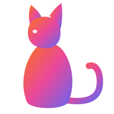

<div align="center">
  <a href="https://purrfectui.com">
    
  </a>
  <h1>purrfect ui</h1>

<p><b>UI that purrs.</b></p>

**Animated React components for shadcn projects. Install with the shadcn CLI or copy the source.**


<a href="https://github.com/Vaibhav91one/purrfect-ui/actions/workflows/ci.yml"></a>


[**purrfectui.com**](https://purrfectui.com) &nbsp;&middot;&nbsp; [Components](https://purrfectui.com/components) &nbsp;&middot;&nbsp; [Follow on X](https://x.com/VrsatileVaibhav)

</div>

<br />

purrfect ui is a shadcn registry built with Next.js, Tailwind CSS and TypeScript. Every component is animated (Motion, or GSAP for Magnetic, or plain CSS and rAF), honors `prefers-reduced-motion` and installs straight into your codebase. You own the code: no package to depend on, restyle anything. The site itself plays synthesized sound cues; the installed components stay silent. The components are extracted from my own projects (Poinu, Mapinly, Bountydesk, portfolio).

### Requirements

- React 19 and Tailwind CSS 4.
- A shadcn theme: run `npx shadcn@latest init` first. The components use its tokens (`background`, `foreground`, `primary`, `muted`, `border`, `input`, ...) and its `cn()` from `@/lib/utils`, so they follow your theme in light and dark.
- Every component takes `className` (merged with `cn()`, so your classes win) and passes the rest of its props (`id`, `style`, `aria-*`, `data-*`, handlers) to its root element.

Renamed so they no longer overwrite shadcn's own files: `button` is now `roll-button`, `tabs` is `glide-tabs`, `toggle` is `stretch-switch` (old URLs redirect).

## Quick start

Install any component with the shadcn CLI:

```bash
npx shadcn@latest add https://purrfectui.com/r/<component>.json
```

For example:

```bash
npx shadcn@latest add https://purrfectui.com/r/roll-button.json
```

Browse every component with a live preview (installable ones also show their source and props) at [purrfectui.com/components](https://purrfectui.com/components).

## MCP (Claude Code, Cursor, Codex)

Not tested end to end yet; tracked in [#1](https://github.com/Vaibhav91one/purrfect-ui/issues/1).

In your project, add this to `components.json`:

```json
{
  "registries": {
    "@purrfectui": "https://purrfectui.com/r/{name}.json"
  }
}
```

Then:

```bash
npx shadcn@latest mcp init --client claude
# or: --client cursor | vscode
```

Ask: `add @purrfectui/roll-button`

Not `add roll-button` on its own. That looks in the default shadcn registry.

## Running locally

```bash
git clone https://github.com/Vaibhav91one/purrfect-ui.git
cd purrfect-ui
pnpm install
pnpm dev          # http://localhost:3000
pnpm registry:build   # after changing a component or registry.json
pnpm build
```

## How it's built

### Layout

- `app/` the platform: the home page and the `/components` gallery (a component opens in a dialog, `?c=<slug>`)
- `registry/<slug>/` one folder per installable component: `<slug>.tsx` (the installable file) and `demo.tsx`
- `lib/components-data.ts` the gallery list (name, category, description); a component counts as installable once it is in `registry.json`
- `lib/component-docs.ts` usage snippet, props and behaviours shown in the dialog
- `registry.json` lists every installable item; `pnpm registry:build` writes `public/r/*.json` (also runs before `pnpm build`)

Next 16: read `node_modules/next/dist/docs/` before relying on older Next APIs (see `AGENTS.md`).

### Sound

Every interaction has a cue, synthesized live by [Cuelume](https://www.npmjs.com/package/cuelume) (no audio files). `components/providers/sound-provider.tsx` owns it: on by default, the saved choice lives in `localStorage` (`sound`), and the first pointerdown/keydown unlocks audio (browsers block it before a gesture). `lib/sound.ts` is the only file that imports Cuelume.

Two ways to add a sound:

- **Attribute**, for a plain click: `data-cuelume-tap | toggle | open | close | navigate | select | type` on the element. `bind()` (called by the provider) listens once for the whole page.
- **From code**, for outcomes: `const { play } = useSound(); play("success", { emphasis: "subtle" })`.

Where sound is wired today:

| Where | Cue |
| --- | --- |
| Notch open / close / menu rows / search | `open`, `close`, `navigate` |
| Notch theme and sound toggles | `toggle`, `tap` |
| Hero "Browse components" link | `navigate` (`data-cuelume-navigate`) |
| Copy buttons (the whole hero install pill, path view, component sheet) | `success`, subtle, only after the copy worked |

Pick the cue by the job (copy = `success` subtle, route change = `navigate`, switch = `toggle`). Cat sounds (purr, meow, steps) are parked in `lib/cat-sounds.ts`, not wired in.

### Toasts

Copying shows a toast. The host is one shared sonner `<Toaster />` in `components/ui/sonner.tsx`, mounted in `app/layout.tsx`; call `toast.success(...)` etc. from `sonner` for anything new.

### "In the wild" clips

A component that came from a real site can show a short clip of it running there: the hero, a scroll to the component, a camera push-in, one interaction, then back to the hero so the loop has no seam. It plays on card hover and in the dialog's "In the wild" tab. Add an entry (`target` is a CSS selector on the live page) to `scripts/capture/clips.mjs`, then run `pnpm capture <slug>` (or `all`, `--base http://localhost:3000` for a local copy of the site). The capture renders frame by frame in virtual time, so it is a true 60fps (960x600) however slow the machine is; it needs Chrome and system `ffmpeg`. The files land in `public/previews/` and the slug is listed in `lib/clips.json`; without a clip nothing extra shows.

### Quality gate for a component

Every component has to pass the same gate before it goes in `registry.json`. The rules come from `CLAUDE.md` and the animate, review-animations, apple-design and break-ui skills.

```bash
pnpm check <slug>            # static rules + eslint + tsc; exit 1 on any FAIL (pnpm check all, --fast skips eslint/tsc)
pnpm check --rules           # every rule and why it exists
pnpm check:selftest          # proves each rule fires on bad code
pnpm check <slug> --install  # scaffolds a throwaway Next app, shadcn-adds the component from :3120/r, tsc + next build
pnpm check:perf <slug|all>   # runtime gate on /dev fixtures (dev server on :3120): long tasks, layout shift, console errors, with and without reduced motion
pnpm check:budget           # page weight on a production server (pnpm build && pnpm start; --base, default :3000): gzipped first-load JS per route, long tasks and CLS scrolling /components
```

CI runs the static gate and `pnpm build` on every push, then the install smoke test for every component in parallel.

A deliberate exception is a comment on the same or previous line: `check-ignore: <rule-id> <reason>`. A WARN needs a one-line reason in the PR; a FAIL blocks.

Port checklist, in order:

1. Copy the component into `registry/<slug>/<slug>.tsx`, strip site-only imports so it is one self-contained file (only `react`, declared `dependencies`, `@/lib/utils`).
2. Wire it: `registry.json` (with `dependencies`), `item()` in `lib/components-data.ts`, `DOCS` in `lib/component-docs.ts` (end `behaviors` with the Reduced-motion line), `DEMOS` in `components/gallery/demos/demos.tsx`.
3. `pnpm check <slug>` has no FAIL.
4. Worst-case states: add `registry/<slug>/worst-case.tsx` (long and unbreakable labels, 0/1/1000 items, missing optional props, RTL, non-Latin text, huge numbers), list it in `app/dev/fixtures.ts`, open `/dev?c=<slug>` (dev only; width and RTL toggles) and fix what breaks (`/break-ui`).
5. Browser pass at 1470 and 390 wide, dark and light, 200% zoom: no overflow, visible focus ring, keyboard path (Tab, Enter/Space, Esc, arrows), reduced motion is gentler not zero, no stuck hover on touch, clean console, no layout shift.
6. Skill reviews: `/review-animations` then `/animate` for its fixes; `/apple-design` for anything gesture or spring (interruptible, velocity handoff, press feedback on pointer-down, rubber-banding).
7. `pnpm check <slug> --install` passes.
8. Optional clip (`scripts/capture/clips.mjs`, `pnpm capture <slug>`). The same recorded clip (`public/previews/<slug>.mp4`, 60fps) is what gets posted.

## Contributing

Issues and pull requests are welcome. See [CONTRIBUTING.md](CONTRIBUTING.md) for how to add a component and the quality gate it has to pass.

## License

[MIT](LICENSE). Use, modify and ship the components in anything you build, personal or commercial.

<div align="center">
  <br />
  <p><sub>Built by <a href="https://vaibhavtomar.com/">Vaibhav</a> &middot; <a href="https://x.com/VrsatileVaibhav">@VrsatileVaibhav</a> &middot; <a href="https://github.com/Vaibhav91one">GitHub</a></sub></p>
</div>
